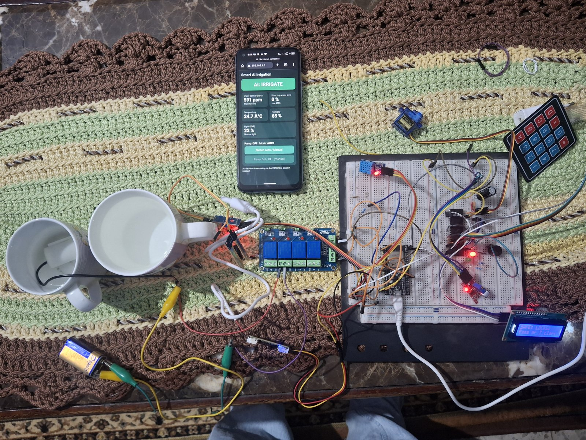

# HTI Microprocessor Projects

**Two microcontroller projects** built for the *Microprocessors and Microcontrollers* course at the
**Higher Technological Institute (HTI), 10th of Ramadan City**, Department of Electrical Engineering (Communications and Electronics).

| | Project | Brain | Highlights |
|---|---|---|---|
| 🔐 | [**Smart Safe**](smart-safe/) | ATmega32A (bare-metal AVR C) | Keypad password **or the owner's voice (speaker voiceprint via ESP32)** to open (first version: 3 claps), I2C LCD, servo lock, 30 s lock-out, password in EEPROM, programmed with an **ESP32 as ISP programmer** |
| 🌱 | [**Smart AI Irrigation**](smart-irrigation/) | ESP32 | Water salinity (TDS), water level, DHT11, LDR → **on-device decision-tree AI** (97.9 % accuracy) decides WAIT / IRRIGATE / ALERT, phone dashboard over Wi-Fi |



## Repository map

```
smart-safe/          ATmega32A firmware (C), ESP32 programmer sketch, tools, images, report
smart-irrigation/    ESP32 firmware, AI training script + generated model, images, report
proteus/             Proteus design guide (schematics + simulation)
```

## Reports

- 📄 [Smart Safe – Technical Report (PDF)](smart-safe/docs/Smart_Safe_Technical_Report.pdf)
- 📄 [Smart Safe Voice ID – Technical Report (PDF)](smart-safe/docs/Smart_Safe_Voice_ID_Report.pdf)
- 📄 [Smart AI Irrigation – Technical Report (PDF)](smart-irrigation/docs/Smart_Irrigation_Technical_Report.pdf)
- 📄 [Proteus Design Guide (PDF)](proteus/Proteus_Design_Guide.pdf)

## Team

| Name | Student ID | GitHub |
|---|---|---|
| Osama Salama | 20230380 | [@xxMANTARxx](https://github.com/xxMANTARxx) |
| Mohamed Khaled Abdo | 20233046 | [@mohamed22-Khaled](https://github.com/mohamed22-Khaled) |
| Ahmed Kamel Ahmed | 20230623 | [@ahmedkamel74](https://github.com/ahmedkamel74) |

**Supervisor:** Assoc. Prof. Dr. Mohamed Tarrad

---

<div dir="rtl">

ده ريبو فيه **مشروعين** عملناهم لمادة *المعالجات الدقيقة والمتحكمات* في **المعهد التكنولوجي العالي بالعاشر من رمضان (HTI)**، قسم الهندسة الكهربية (اتصالات وإلكترونيات).

- 🔐 **[الخزنة الذكية](smart-safe/):** شغالة بـ ATmega32A. بتتفتح بالباسورد من الكيباد **أو ببصمة صوت صاحبها** (النسخة الأولى كانت بـ 3 تصقيفات)، وبتتقفل بزرار C أو تصقيفتين. فيها شاشة LCD وسيرفو بيقفل، وبتقفل نفسها 30 ثانية بعد 3 مرات غلط، والباسورد بيتحفظ في الـ EEPROM. وحرقنا البرنامج على الشريحة باستخدام **ESP32 كمبرمجة**.
- 🌱 **[الري الذكي بالذكاء الاصطناعي](smart-irrigation/):** شغال بـ ESP32. بيقيس ملوحة المية (TDS)، ومستوى المية، والحرارة والرطوبة (DHT11)، والضوء (LDR). **موديل AI (Decision Tree)** شغال على الـ ESP32 نفسه ودقته 97.9%، وبيقرر: يستنى، أو يسقي، أو يدي تنبيه لو المية مالحة. وكل حاجة بتبان على الموبايل من غير إنترنت.

**الفريق:** أسامة سلامة · محمد خالد عبده · أحمد كامل أحمد — **إشراف:** أ.د.م. محمد طراد

</div>
