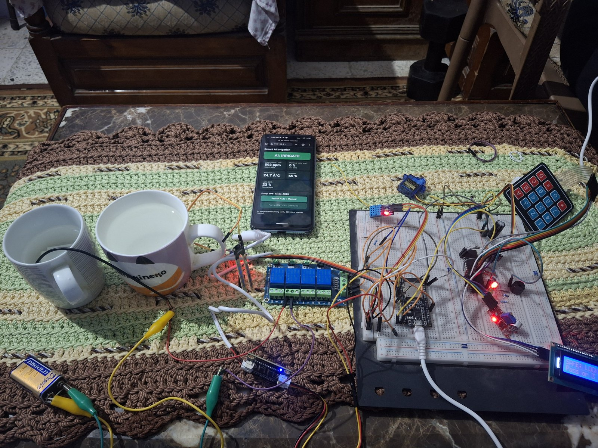
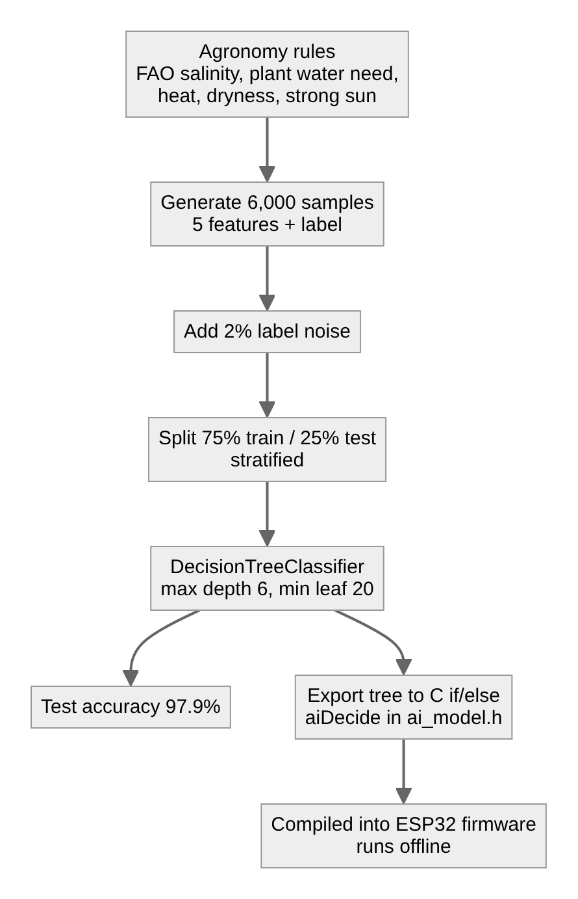
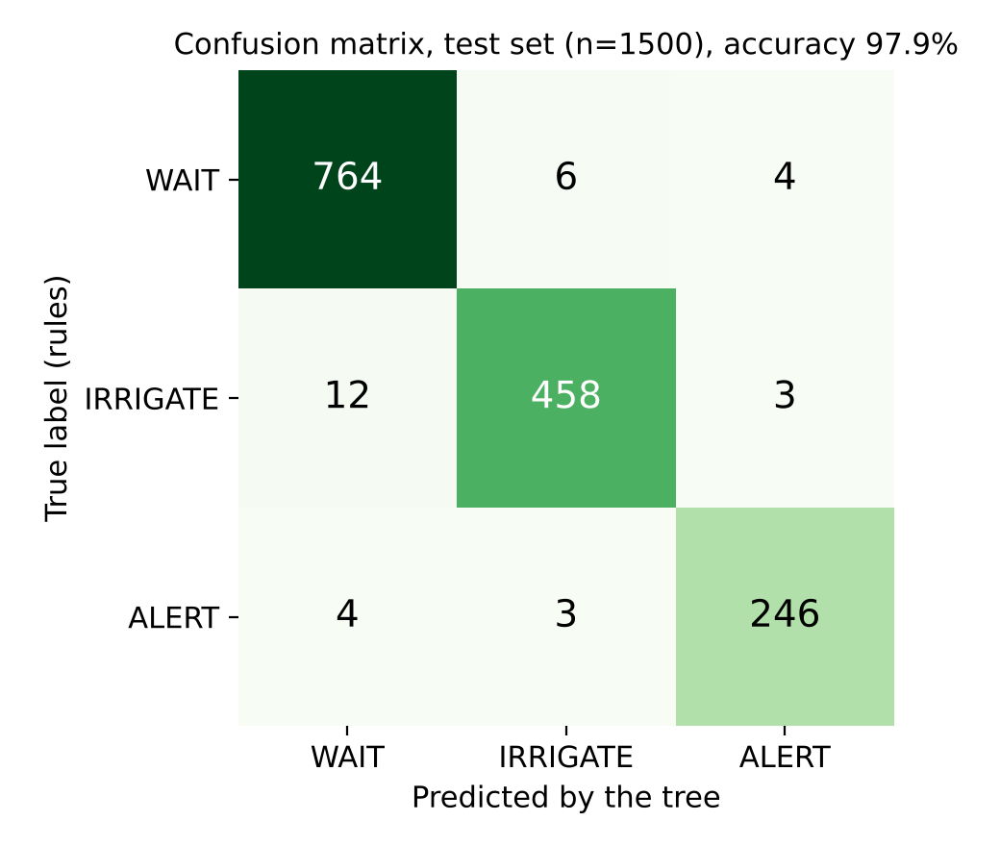
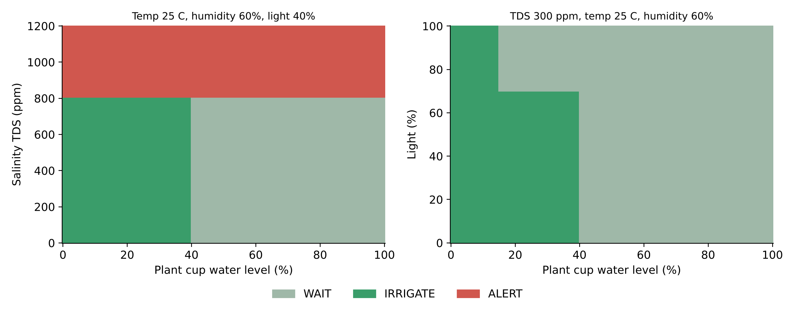
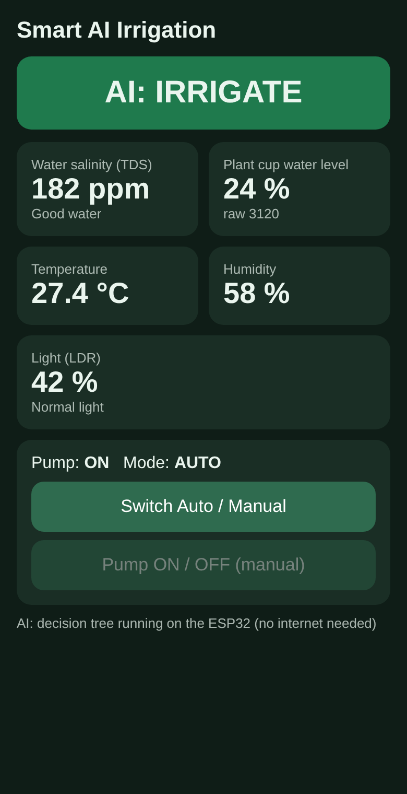
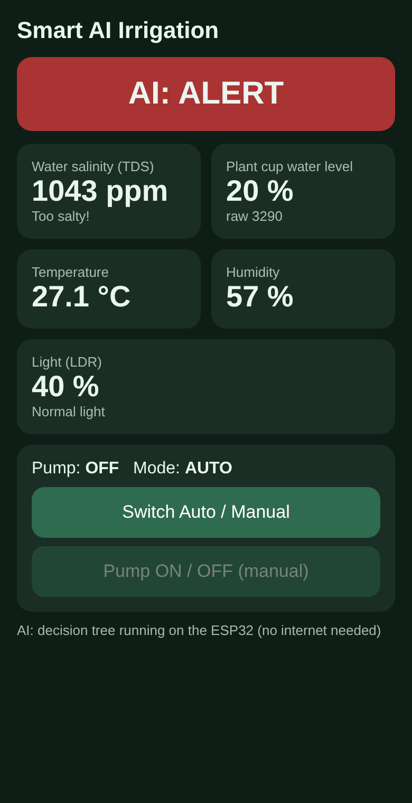

# 🌱 Smart AI Irrigation – ESP32

An ESP32 irrigation controller that decides **when to water a plant** and **refuses to pump salty water**.
A **decision-tree model** trained in Python runs **on the ESP32 itself** (no internet).

| Input | Sensor | ESP32 pin |
|---|---|---|
| Water salinity (ppm) | TDS Meter V1.0 | GPIO35 |
| Plant cup water level (%) | HW-080 | GPIO34 |
| Air temperature / humidity | DHT11 | GPIO4 |
| Light (%) | LDR + 10 kΩ divider | GPIO32 |

| Output | ESP32 pin |
|---|---|
| Relay IN1 → pump | GPIO26 (active HIGH) |
| Green LED (pump on) / Red LED (alert) | GPIO18 / GPIO19 |
| Buzzer | GPIO23 |



## AI decisions

| Decision | When | Action |
|---|---|---|
| **WAIT** | Enough water, or strong sun and not urgent | Pump off |
| **IRRIGATE** | Plant needs water and water is OK | Pump 3 s on / 8 s settle |
| **ALERT** | TDS > 800 ppm | Pump **blocked**, red LED, 3 beeps |

The model is a `DecisionTreeClassifier` (depth 6, 30 leaves) trained on **6,000 samples** labelled with agronomic rules
(FAO salinity guide; water earlier when hot > 30 °C or dry < 40 % RH, later when cold < 18 °C; wait in strong sun unless very dry).
**Test accuracy: 97.9 %.** The training script exports the tree as C code into `ai_model.h`.





## Files

| File | What it does |
|---|---|
| [`firmware/smart_irrigation/smart_irrigation.ino`](firmware/smart_irrigation/smart_irrigation.ino) | Sensors, AI call, pump control, Wi-Fi web dashboard |
| [`firmware/smart_irrigation/ai_model.h`](firmware/smart_irrigation/ai_model.h) | Generated decision tree (`aiDecide()`) |
| [`firmware/smart_irrigation_one_file/`](firmware/smart_irrigation_one_file/) | Same program in one file (model included) |
| [`ai/train_model.py`](ai/train_model.py) | Generates the data, trains, evaluates and exports the model |

### Run it

1. Arduino IDE → board **ESP32 Dev Module** → install **DHT sensor library** (Adafruit, "Install all").
2. Open `firmware/smart_irrigation/smart_irrigation.ino` and upload.
3. On the phone connect to Wi-Fi **SmartIrrigation** (password `12345678`) and open **http://192.168.4.1**.

### Retrain the model

```bash
pip install scikit-learn numpy
cd ai && python train_model.py      # writes ai_model.h – copy it next to the .ino
```

Real readings can be added in `ai/my_readings.csv` (`tray_level,tds,temp,humidity,light,label`); the ESP32 prints lines in this format on the Serial Monitor.

> ⚠️ Power the pump from its **own battery** through the relay (battery + → COM, NO → pump +, pump – → battery –). Sharing the ESP32 supply caused brown-out resets. We used an old 9 V battery that measured 5–6 V; a regulated 5 V supply is better.

<p align="center"> </p>

📄 Full details: [Technical report (PDF)](docs/Smart_Irrigation_Technical_Report.pdf)

---

<div dir="rtl">

نظام ري بيشتغل بـ **ESP32**. بيقرر إمتى يسقي الزرعة، و**بيرفض يشغّل المضخة لو المية مالحة**.

- **الحساسات:** ملوحة المية (TDS)، مستوى المية في كوباية الزرعة (HW-080)، الحرارة والرطوبة (DHT11)، والضوء (LDR).
- **الذكاء الاصطناعي:** موديل Decision Tree اتدرّب على 6000 قراءة، ودقته **97.9%**. شغال على الـ ESP32 نفسه ومش محتاج إنترنت.
- **القرارات:** WAIT (استنى)، IRRIGATE (اسقي: المضخة تشتغل 3 ثواني وتقف 8)، ALERT (المية مالحة فوق 800 ppm، فالمضخة تتقفل واللمبة الحمرا تنور والبازر يصفّر).
- **الموبايل:** ادخل على الواي فاي `SmartIrrigation` (الباسورد 12345678)، وافتح `192.168.4.1`. هتلاقي كل القراءات وقرار الـ AI، وتقدر تشغّل المضخة بإيدك.

</div>
