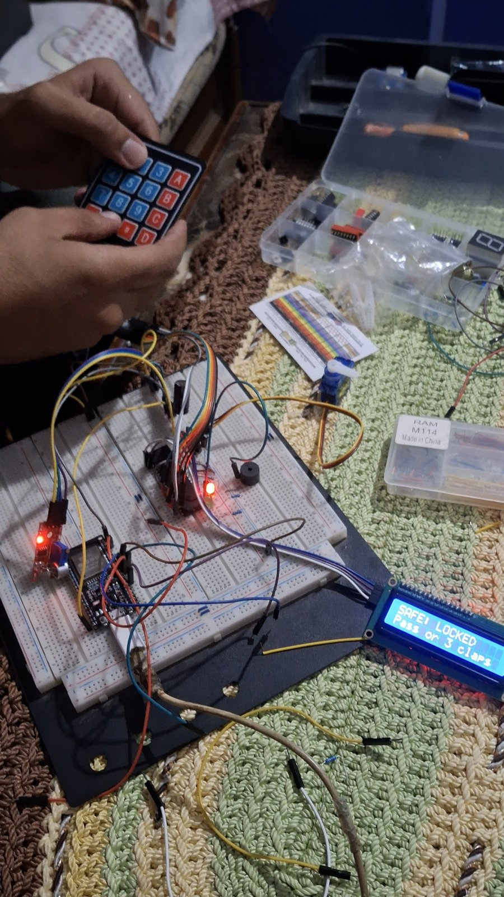
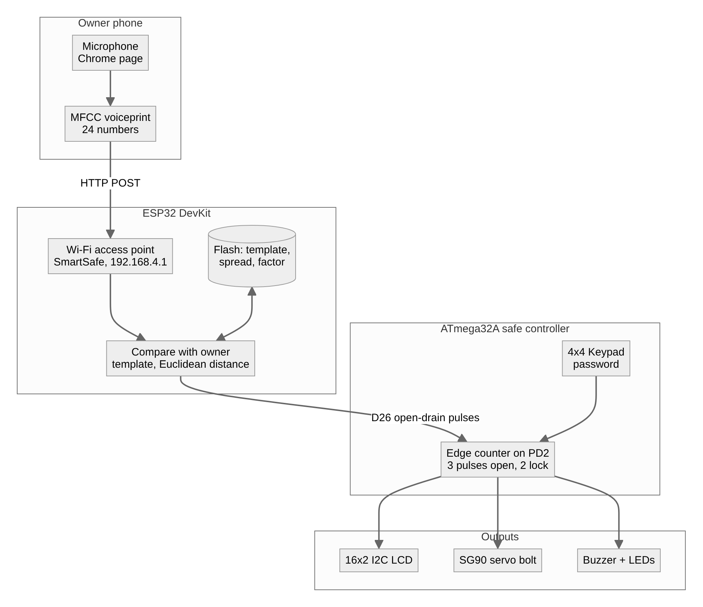
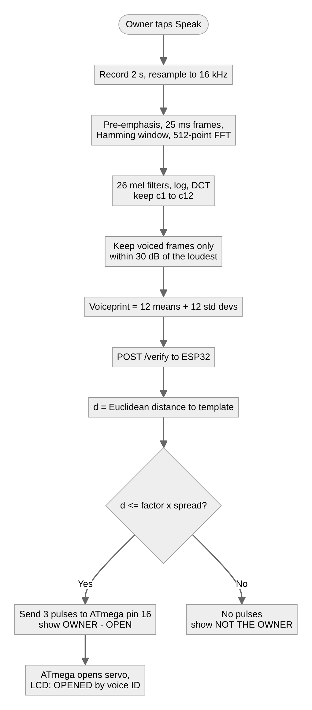
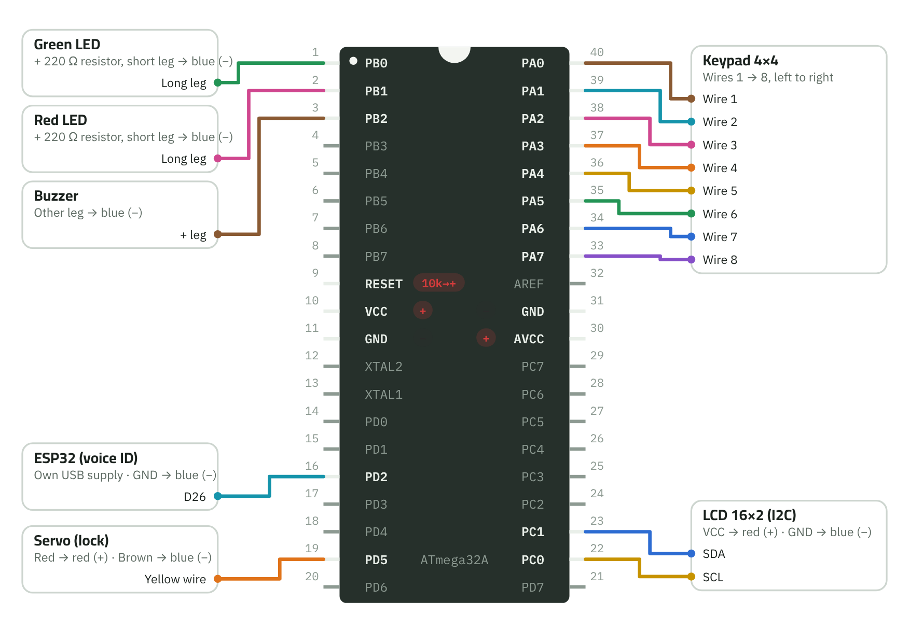
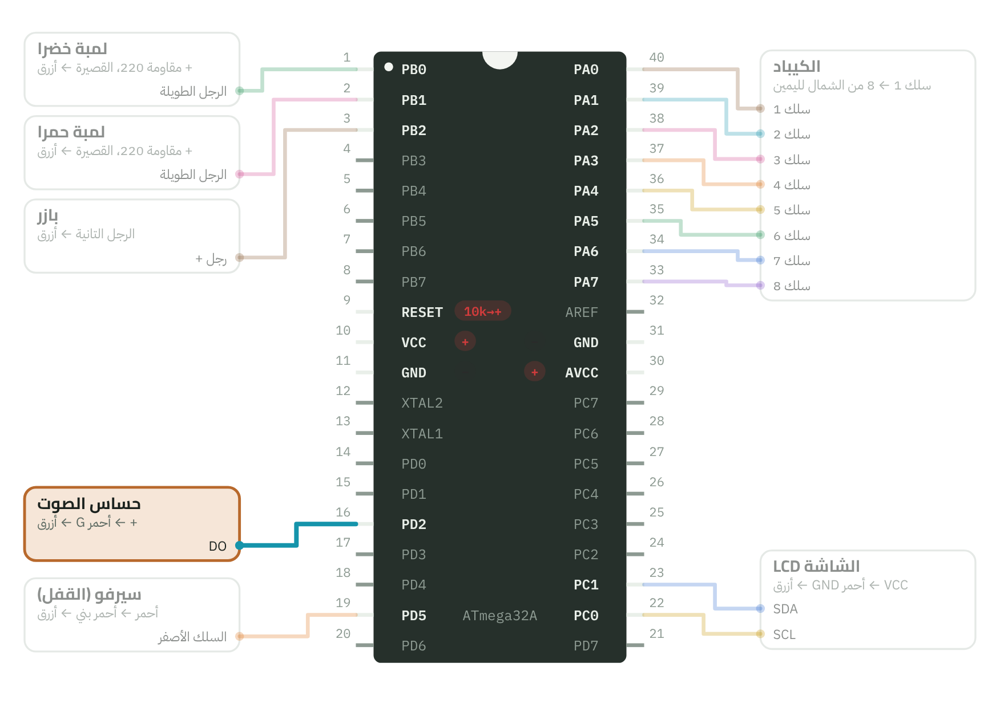
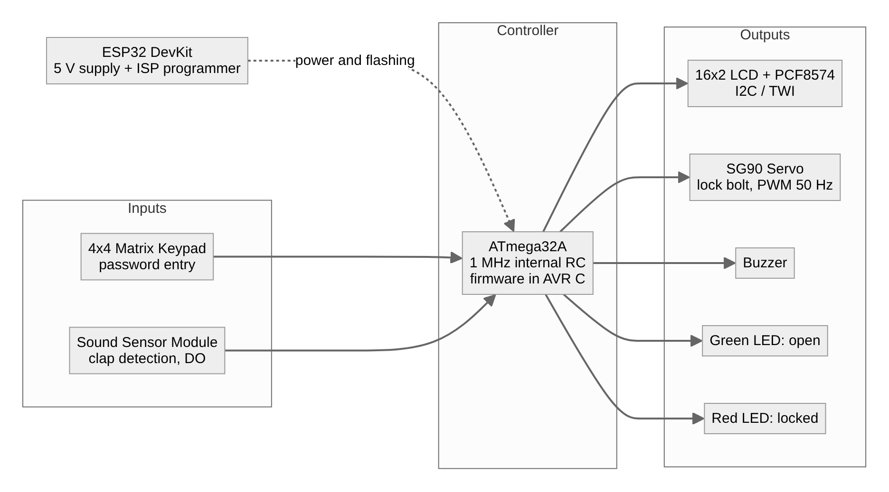
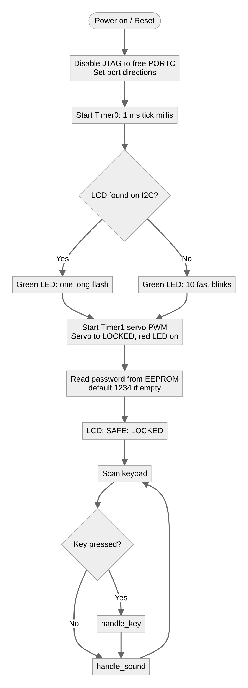

# 🔐 Smart Safe – ATmega32A

An electronic safe built around the **ATmega32A** and written in **bare-metal AVR C** (no Arduino libraries).

- Open with the **keypad password + `#`** or with **3 claps**
- Lock with **key `C`** or **2 claps**
- **30-second lock-out** after 3 wrong passwords
- Change the password with **`A`** (4–8 digits), saved in **EEPROM**
- 16×2 **I2C LCD** (PCF8574, address found automatically), **SG90 servo** lock, buzzer, green/red LEDs
- Programmed with an **ESP32 acting as an AVR in-system programmer** (no USBasp needed)



## 🎙️ New: Voice ID version (speaker voiceprint)

The clap input is replaced by **real speaker verification**: the safe opens only for the **voice of one enrolled owner**.



- The **ESP32** creates a Wi-Fi access point `SmartSafe` (password `12345678`) and serves a page at `http://192.168.4.1`.
- The phone page records 2 s of speech and computes an **MFCC voiceprint** (12 means + 12 standard deviations).
- **Enrolment:** the owner says the same sentence 3 times; the template and its spread are saved in the ESP32 flash.
- **Verify:** Euclidean distance to the template; accepted if `d <= factor x spread` (factor 1.8, slider on the page).
- On a match the ESP32 sends **3 open-drain pulses** to ATmega32A **pin 16 (PD2)** → safe opens "by voice ID". The Lock button sends 2 pulses.
- Wiring: **ESP32 D26 → ATmega32A pin 16** and **GND → GND**. The sketch pulses D25, D26 and D27 together, so any of them can be used.
- Android Chrome needs `chrome://flags` → *Insecure origins treated as secure* → `http://192.168.4.1` (microphone access on HTTP).

| File | What it does |
|---|---|
| [`esp32-voice-id/voice_id_safe/voice_id_safe.ino`](esp32-voice-id/voice_id_safe/voice_id_safe.ino) | ESP32: Wi-Fi page, MFCC voiceprint (in the browser), enrol / verify, pulses to the safe |
| [`firmware/smart_safe_voice/smart_safe_voice.c`](firmware/smart_safe_voice/smart_safe_voice.c) | ATmega32A firmware: password + voice ID (PD2 with internal pull-up, 3 pulses open / 2 lock) |
| [`programmer/flash_safe_voice/flash_safe_voice.ino`](programmer/flash_safe_voice/flash_safe_voice.ino) | ESP32 flasher with the voice firmware inside (2,712 bytes) |
| [`docs/Smart_Safe_Voice_ID_Report.pdf`](docs/Smart_Safe_Voice_ID_Report.pdf) | Technical report of the voice ID version (IEEE references) |

Steps: flash `flash_safe_voice` into the ATmega32A → upload `voice_id_safe` to the ESP32 → connect D26 + GND → enrol the owner on the phone → speak to open.




The LCD driver (`firmware/common/lcd_i2c.h`) now has a **timeout on every I2C wait**, so a missing LCD can never freeze the safe (the green LED blinks 10 times fast instead).

## Hardware

| Signal | ATmega32A pin |
|---|---|
| Keypad rows 1–4 | PA0–PA3 (pins 40–37) |
| Keypad columns 1–4 | PA4–PA7 (pins 36–33) |
| LCD SCL / SDA | PC0 (22) / PC1 (23) |
| Servo signal (OC1A) | PD5 (19) |
| Sound sensor DO | PD2 (16) |
| Green LED / Red LED / Buzzer | PB0 (1) / PB1 (2) / PB2 (3) |
| VCC, AVCC / GND | 10, 30 / 11, 31 |
| RESET | 9 (10 kΩ to +5 V) |

Clock: internal RC **1 MHz** (factory fuses `E1 / 99`). Supply: 5 V from the ESP32 `VIN` pin.
Also needed: 2 × 220 Ω (LEDs), 100 nF + 470 µF capacitors.




## Firmware

| File | What it does |
|---|---|
| [`firmware/smart_safe/smart_safe.c`](firmware/smart_safe/smart_safe.c) | Main program: keypad, password, lock-out, EEPROM, claps, servo |
| [`firmware/common/lcd_i2c.h`](firmware/common/lcd_i2c.h) | TWI driver + HD44780 LCD in 4-bit mode over PCF8574 |
| [`firmware/common/millis.h`](firmware/common/millis.h) | Timer0 CTC → 1 ms tick |
| [`firmware/smart_safe/smart_safe.hex`](firmware/smart_safe/smart_safe.hex) | Ready-to-flash program (2,620 bytes) |

Build it yourself:

```bash
cd firmware/smart_safe
avr-gcc -mmcu=atmega32 -Os -DF_CPU=1000000UL smart_safe.c -o smart_safe.elf
avr-objcopy -O ihex -R .eeprom smart_safe.elf smart_safe.hex
```

Memory: flash 2,620 B (8 %), SRAM 376 B (18 %), EEPROM 9 B.



## Programming the ATmega32A with an ESP32

[`programmer/flash_safe/flash_safe.ino`](programmer/flash_safe/flash_safe.ino) already contains the firmware as a byte array.
Upload it to an ESP32 ("ESP32 Dev Module"), open the Serial Monitor at **115200** and wait for `DONE: verify 100% OK`.

| ESP32 | ATmega32A |
|---|---|
| G23 | pin 6 (MOSI) |
| G19 → 1 kΩ | pin 7 (MISO) |
| G18 | pin 8 (SCK) |
| G5 | pin 9 (RESET) |
| G4 | pin 13 (XTAL1, 1 MHz clock) |
| VIN / GND | + / – rails |

After flashing, remove the 5 programming wires; the ATmega32A runs alone.
The [`tools/`](tools/) folder has helper sketches (`check_wiring`, `find_pins`) and a blink test used while debugging the programmer.

## How to use

| Key / action | Effect |
|---|---|
| `0–9` then `#` | Enter password (default **1234**) |
| `*` | Clear |
| `C` / 2 claps | Lock |
| 3 claps | Open |
| `A` (while open) | New password, then `#` |

📄 Full details: [Technical report (PDF)](docs/Smart_Safe_Technical_Report.pdf)

---

<div dir="rtl">

خزنة إلكترونية متحكم فيها **ATmega32A** ومكتوبة بلغة **C**.

- **بتتفتح:** بالباسورد وبعده `#`، أو بـ **3 تصقيفات**.
- **بتتقفل:** بزرار `C`، أو بـ **تصقيفتين**.
- لو الباسورد اتكتب غلط 3 مرات، الخزنة **بتقفل نفسها 30 ثانية**.
- **تغيير الباسورد:** وهي مفتوحة دوس `A`، اكتب الباسورد الجديد، ودوس `#`. الباسورد بيتحفظ في الـ EEPROM حتى لو الكهربا فصلت.
- **الباسورد الافتراضي:** 1234

**الحرق على الشريحة:** ارفع ملف `programmer/flash_safe/flash_safe.ino` على الـ ESP32، ووصّل الخمس سلوك اللي في الجدول فوق، وافتح الـ Serial Monitor. لما تظهر كلمة `DONE` شيل السلوك.

</div>
